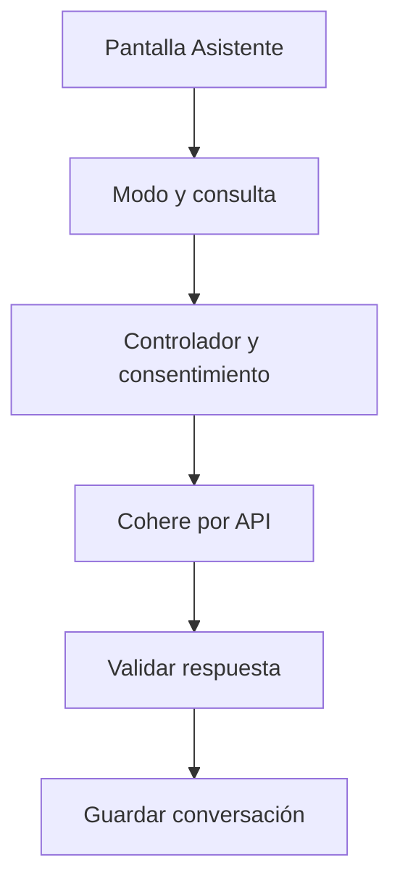

# Tomás Menossi · Chat con Cohere

Responsabilidad de estudio y revisión de la edición 50; no es una declaración de autoría.

## Mapa mental

## Archivos y funciones

Pantalla: [Asistente.jsx](../client/src/pages/Asistente.jsx). Backend: [controllers/ia.controller.js](../controllers/ia.controller.js). Las rutas están en [usuarios.routes.js](../routes/usuarios.routes.js) y [gimnasio.routes.js](../routes/gimnasio.routes.js).

| Función | Qué hace y qué tenés que poder explicar |
| --- | --- |
| [estadoIA](../controllers/ia.controller.js#L168) | Informa si hay clave configurada; no asegura que el proveedor esté disponible. |
| [responderConsulta](../controllers/ia.controller.js#L51) | Comprueba consentimiento, modo y propiedad de la conversación; obtiene contexto y guarda los dos mensajes. |
| [responderconsulta](../controllers/ia.controller.js#L31) | Construye la instrucción de entrenador/soporte y valida el texto JSON devuelto por Cohere. |
| [generarConIA](../controllers/ia.controller.js#L4) | Hace una llamada HTTP al proveedor con la clave privada y un límite de 45 segundos; no reintenta. |
| [listarConversaciones](../controllers/ia.controller.js#L135) | Lista únicamente las conversaciones del usuario conectado. |
| [verConversacion](../controllers/ia.controller.js#L149) | Comprueba el dueño antes de devolver sus mensajes. |

## Librerías

React maneja consulta, modo, conversación y estado de espera. Axios llama al backend. fetch hace la llamada externa; AbortSignal corta la espera; Sequelize conserva planes y mensajes. La clave solo vive en .env del servidor.

## Qué entender

La IA es externa y real. Entendé system/user/assistant, JSON, historial de diez mensajes, consentimiento, clave privada y timeout. El chat solo conversa: no genera ni modifica planes, ni ejecuta acciones sobre la cuenta.

Ubicá useState, useEffect cuando se use, los eventos del formulario y las llamadas Axios. Para cada función explicá entradas, validación, consulta y respuesta; no hace falta memorizar palabra por palabra.

## Recorrido de defensa

En Mi cuenta activá consentimiento. En Asistente elegí Soporte, preguntá cómo registrar un entrenamiento y hacé un seguimiento. Mostrá que se conserva la conversación y que no hay botones para generar planes.

## Base común

Pantalla → ruta → controlador → modelo → MySQL. Las relaciones están en [models/index.js](../models/index.js). La confirmación está en [Confirmar.jsx](../client/src/components/Confirmar.jsx). Consultá el [alcance](../docs/ALCANCE.md). Vite solo inicia o compila React; no es una función del gimnasio ni hay que estudiar sus mecanismos internos.
