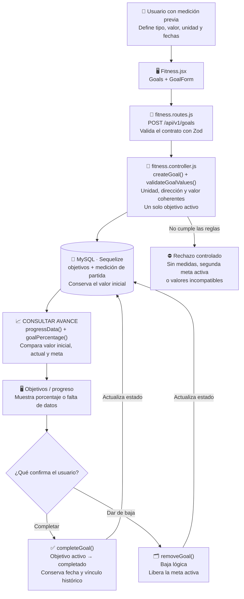

# Paulo López: Objetivos personales

Guía exclusiva de la **preentrega**, no de todas las funciones del proyecto final. Es una asignación de estudio y revisión; no afirma autoría histórica. El código se preparó con asistencia de Codex.

## Mapa visual para ubicarte

La meta une un punto de partida con un resultado deseado. El porcentaje se calcula al consultar; completar una meta es una acción confirmada del usuario.

Gade carga las medidas, vos definís las reglas de la meta y Mateo muestra el progreso. Completar o dar de baja no borra el vínculo histórico de una rutina.

## Tu funcionalidad

**Casos:** CU009, CU010, CU012, CU013. **Pantallas:** `/objetivos`.

Gade prepara medidas; Mateo presenta gráficas/porcentajes; Valentín asocia la rutina a la meta.

## Archivos que tenés que ubicar

- [client/src/pages/Fitness.jsx](../client/src/pages/Fitness.jsx).
- [controllers/fitness.controller.js](../controllers/fitness.controller.js).
- [shared/schemas.js](../shared/schemas.js).
- [models/Objetivo.model.js](../models/Objetivo.model.js).

## Qué hace cada función importante

| Función                                                         | Para qué sirve                                                                        |
| --------------------------------------------------------------- | ------------------------------------------------------------------------------------- |
| [Goals](../client/src/pages/Fitness.jsx#L542)                   | Lista metas y ofrece creación, finalización y baja con confirmaciones.                |
| [GoalForm](../client/src/pages/Fitness.jsx#L445)                | Recoge tipo, valor, unidad, frecuencia y fechas sin perder datos ante error.          |
| [createGoal](../controllers/fitness.controller.js#L242)         | Exige medidas, valida la meta y evita dos objetivos activos.                          |
| [validateGoalValues](../controllers/fitness.controller.js#L121) | Comprueba coherencia entre tipo, unidad y valor alcanzable desde la medición inicial. |
| [activeGoal](../controllers/fitness.controller.js#L34)          | Busca la meta activa del propietario.                                                 |
| [completeGoal](../controllers/fitness.controller.js#L253)       | Solo completa una meta activa y conserva la fecha de finalización.                    |
| [removeGoal](../controllers/fitness.controller.js#L261)         | Aplica baja lógica sin borrar el historial de planes ya vinculados.                   |

Los enlaces llevan a la declaración real. Entendé qué recibe, qué valida, qué devuelve y qué puede fallar; no hace falta repetir cada palabra del código. Las operaciones de soporte compartidas se explican en [el recorrido común](README.md).

## Recorrido que tenés que poder explicar

Medidas de Gade -> formulario de meta -> validación -> objetivo activo -> cálculo de avance de Mateo -> completar o dar de baja con confirmación.

**Datos afectados o consultados:** objetivos, mediciones_fisicas, entrenamientos y bitacora. La pantalla no escribe SQL directamente: llama a Express y Sequelize se ocupa de las consultas. Las escrituras conservan autorización, transacción, bitácora e integridad.

## Librerías de tu recorrido

React y React Router administran pantallas y acciones. Express recibe solicitudes; Zod valida contratos; Sequelize/mysql2 persisten o consultan MySQL. En cuentas se usan crypto de Node y Nodemailer para seguridad y recuperación; el correo de desarrollo es un archivo, no un envío real. Estudiá las librerías que realmente intervienen en tu función, no las dependencias completas.

## Demostración para exponer

1. Crear una meta coherente con las medidas.
2. Probar unidad incompatible y segunda meta activa.
3. Cancelar la finalización y demostrar que no cambia.
4. Completarla y mostrar que la rutina conserva su vínculo histórico.

## Preguntas que deberías poder responder

- ¿Cuál es la diferencia entre esta pantalla y su ruta de API?
- ¿Qué datos entran, qué error se valida y qué respuesta recibe React?
- ¿Qué queda guardado y cómo se comprueba después de recargar?
- ¿Cómo se evita acceder a registros ajenos?
- ¿Qué operación se cancela sin cambiar la base?

## Límites de la preentrega

No hay nutrición, administración ni generación/adaptación IA de planes en esta copia. El chat sí usa Cohere real si la clave privada y su cuota están disponibles. La base conserva tablas del DER futuro, pero tener una tabla o un método UML declarado no equivale a una funcionalidad terminada. Consultá [alcance](../docs/ALCANCE.md) y [verificación](../docs/VERIFICACION.md).

Antes de exponer, registrá tus revisiones/aportes efectivos en [REPARTO.md](../REPARTO.md). No atribuyas cambios que no realizaste.
