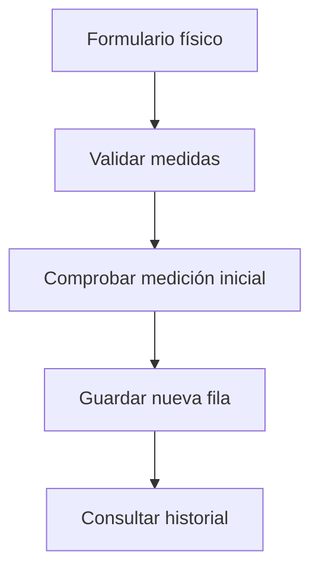

# Gade Silva y Lápiz · Mediciones y perfil físico

Responsabilidad de estudio y revisión de la edición 50; no es una declaración de autoría.

## Mapa mental

## Archivos y funciones

Pantalla: [Medidas.jsx](../client/src/pages/Medidas.jsx). Backend: [controllers/mediciones.controller.js](../controllers/mediciones.controller.js). Las rutas están en [usuarios.routes.js](../routes/usuarios.routes.js) y [gimnasio.routes.js](../routes/gimnasio.routes.js).

| Función | Qué hace y qué tenés que poder explicar |
| --- | --- |
| [actualizarMedicion](../controllers/mediciones.controller.js#L52) | Agrega una medición inicial o posterior, sin sobrescribir las anteriores; valida porcentajes, fecha y perímetros. |
| [listarMediciones](../controllers/mediciones.controller.js#L136) | Consulta el historial propio del más reciente al más antiguo. |
| [cambiarPeso](../controllers/mediciones.controller.js#L4) | Valida peso entre 20 y 400 kg. |
| [cambiarAltura](../controllers/mediciones.controller.js#L14) | Valida altura entre 80 y 250 cm. |
| [cambiarPorcMusculo](../controllers/mediciones.controller.js#L24) | Acepta un porcentaje muscular válido o ausencia del dato. |
| [cambiarPorcGraso](../controllers/mediciones.controller.js#L35) | Acepta un porcentaje de grasa válido o ausencia del dato. |
| [cambiarNivelActividad](../controllers/mediciones.controller.js#L46) | Limita actividad a baja, media o alta. |

## Librerías

React y Axios cargan el formulario. Sequelize agrega filas de MedicionFisica. Se mantienen los registros anteriores para que el panel pueda compararlos.

## Qué entender

Peso, altura, porcentajes y perímetros tienen unidades y rangos. La primera medición es única. Una actualización agrega historial; no reemplaza la anterior. Un dato ausente es null, no cero.

Ubicá useState, useEffect cuando se use, los eventos del formulario y las llamadas Axios. Para cada función explicá entradas, validación, consulta y respuesta; no hace falta memorizar palabra por palabra.

## Recorrido de defensa

Cargá una primera medición y luego otra con peso distinto. Mostrá ambas filas y probá un dato fuera de rango.

## Base común

Pantalla → ruta → controlador → modelo → MySQL. Las relaciones están en [models/index.js](../models/index.js). La confirmación está en [Confirmar.jsx](../client/src/components/Confirmar.jsx). Consultá el [alcance](../docs/ALCANCE.md). Vite solo inicia o compila React; no es una función del gimnasio ni hay que estudiar sus mecanismos internos.
