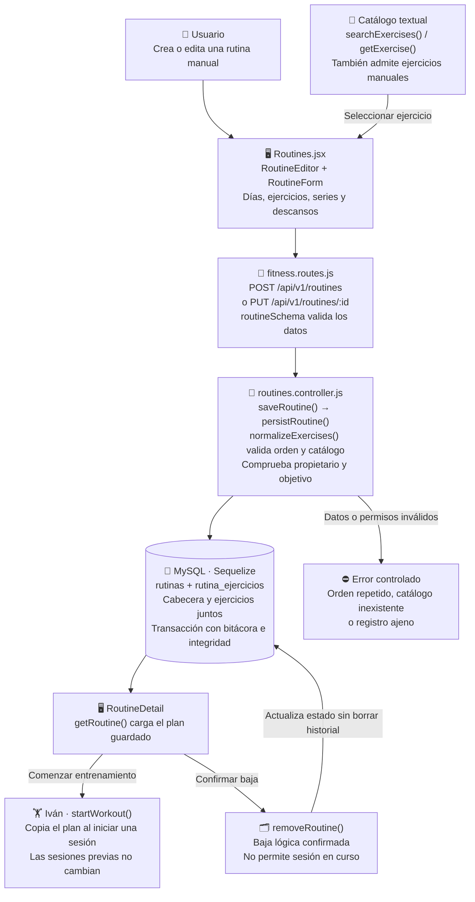

# Valentín Schueld: Rutinas manuales

Guía exclusiva de la **preentrega**, no de todas las funciones del proyecto final. Es una asignación de estudio y revisión; no afirma autoría histórica. El código se preparó con asistencia de Codex.

## Mapa visual para ubicarte

El editor arma el plan; el controlador lo valida y guarda; el detalle lo vuelve a leer. La ejecución de ese plan pasa al módulo de Iván.

En esta versión las rutinas son manuales. Joaquín explica el catálogo; Iván registra el entrenamiento. La transacción impide guardar la cabecera sin sus ejercicios.

## Tu funcionalidad

**Casos:** CU014, CU016, CU018, CU020. **Pantallas:** `/rutinas, /rutinas/nueva, /rutinas/:id/editar`.

En esta preentrega no estudiás dietas porque quedaron fuera de alcance. Las rutinas son manuales: no hay botón ni API de generación IA.

## Archivos que tenés que ubicar

- [client/src/pages/Routines.jsx](../client/src/pages/Routines.jsx).
- [controllers/routines.controller.js](../controllers/routines.controller.js).
- [shared/schemas.js](../shared/schemas.js).
- [models/Rutina.model.js](../models/Rutina.model.js).
- [models/RutinaEjercicio.model.js](../models/RutinaEjercicio.model.js).

## Qué hace cada función importante

| Función                                                         | Para qué sirve                                                                |
| --------------------------------------------------------------- | ----------------------------------------------------------------------------- |
| [RoutineList](../client/src/pages/Routines.jsx#L192)            | Lista rutinas activas y ofrece crear o abrir una.                             |
| [RoutineEditor](../client/src/pages/Routines.jsx#L244)          | Carga la rutina al editar o prepara una nueva.                                |
| [RoutineForm](../client/src/pages/Routines.jsx#L253)            | Organiza ejercicios por día, series, repeticiones, cargas, descansos y orden. |
| [normalizeExercises](../controllers/routines.controller.js#L43) | Verifica orden y catálogo antes de guardar.                                   |
| [persistRoutine](../controllers/routines.controller.js#L59)     | Crea o actualiza la rutina y sus ejercicios en la transacción autorizada.     |
| [saveRoutine](../controllers/routines.controller.js#L117)       | Coordina validación, nombres UML, integridad y persistencia manual.           |
| [removeRoutine](../controllers/routines.controller.js#L138)     | Hace baja lógica; impide borrar si existe una sesión en curso.                |

Los enlaces llevan a la declaración real. Entendé qué recibe, qué valida, qué devuelve y qué puede fallar; no hace falta repetir cada palabra del código. Las operaciones de soporte compartidas se explican en [el recorrido común](README.md).

## Recorrido que tenés que poder explicar

Crear rutina -> elegir ejercicios de Joaquín -> guardar días y cargas -> editar -> Iván registra sesiones -> baja conserva historial.

**Datos afectados o consultados:** rutinas, rutina_ejercicios, objetivos, entrenamientos y bitacora. La pantalla no escribe SQL directamente: llama a Express y Sequelize se ocupa de las consultas. Las escrituras conservan autorización, transacción, bitácora e integridad.

## Librerías de tu recorrido

React y React Router administran pantallas y acciones. Express recibe solicitudes; Zod valida contratos; Sequelize/mysql2 persisten o consultan MySQL. En cuentas se usan crypto de Node y Nodemailer para seguridad y recuperación; el correo de desarrollo es un archivo, no un envío real. Estudiá las librerías que realmente intervienen en tu función, no las dependencias completas.

## Demostración para exponer

1. Crear una rutina con dos ejercicios.
2. Editar un ejercicio y volver a cargar para comprobar persistencia.
3. Cancelar la baja y después confirmarla.
4. Explicar por qué no se borra una rutina con entrenamiento en curso.

## Preguntas que deberías poder responder

- ¿Cuál es la diferencia entre esta pantalla y su ruta de API?
- ¿Qué datos entran, qué error se valida y qué respuesta recibe React?
- ¿Qué queda guardado y cómo se comprueba después de recargar?
- ¿Cómo se evita acceder a registros ajenos?
- ¿Qué operación se cancela sin cambiar la base?

## Límites de la preentrega

No hay nutrición, administración ni generación/adaptación IA de planes en esta copia. El chat sí usa Cohere real si la clave privada y su cuota están disponibles. La base conserva tablas del DER futuro, pero tener una tabla o un método UML declarado no equivale a una funcionalidad terminada. Consultá [alcance](../docs/ALCANCE.md) y [verificación](../docs/VERIFICACION.md).

Antes de exponer, registrá tus revisiones/aportes efectivos en [REPARTO.md](../REPARTO.md). No atribuyas cambios que no realizaste.
