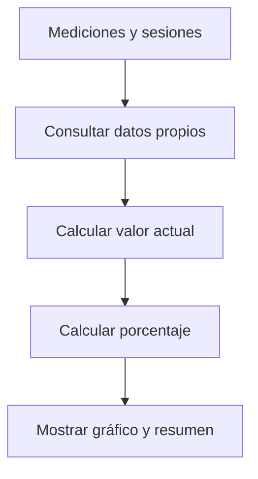

# Mateo Romani · Panel y visualización del progreso

Responsabilidad de estudio y revisión de la edición 50; no es una declaración de autoría.

## Mapa mental

## Archivos y funciones

Pantalla: [Progreso.jsx](../client/src/pages/Progreso.jsx). Backend: [controllers/progreso.controller.js](../controllers/progreso.controller.js). Las rutas están en [usuarios.routes.js](../routes/usuarios.routes.js) y [gimnasio.routes.js](../routes/gimnasio.routes.js).

| Función | Qué hace y qué tenés que poder explicar |
| --- | --- |
| [verProgreso](../controllers/progreso.controller.js#L19) | Consulta mediciones y sesiones propias, calcula avances por tipo de objetivo y respeta el instante de cierre. |
| [calcularPorcentaje](../controllers/progreso.controller.js#L8) | Compara inicio, valor actual y meta; limita a 0–100 y trata el caso de inicio igual a meta. |

## Librerías

React y Axios consultan el resumen; Recharts dibuja el historial de peso. Sequelize obtiene medidas, objetivos, rutinas y entrenamientos. Intl aplica la zona horaria.

## Qué entender

Diferenciar historial real, objetivo y porcentaje. Un objetivo completado conserva su corte temporal. La frecuencia cuenta sesiones completas semanales; resistencia usa distancia. No hay estadísticas de nutrición en esta entrega.

Ubicá useState, useEffect cuando se use, los eventos del formulario y las llamadas Axios. Para cada función explicá entradas, validación, consulta y respuesta; no hace falta memorizar palabra por palabra.

## Recorrido de defensa

Mostrá dos mediciones en el gráfico. Explicá con un ejemplo: inicio 80, meta 70, actual 75 representa 50 %. Mostrá los contadores reales de rutinas y sesiones.

## Base común

Pantalla → ruta → controlador → modelo → MySQL. Las relaciones están en [models/index.js](../models/index.js). La confirmación está en [Confirmar.jsx](../client/src/components/Confirmar.jsx). Consultá el [alcance](../docs/ALCANCE.md). Vite solo inicia o compila React; no es una función del gimnasio ni hay que estudiar sus mecanismos internos.
