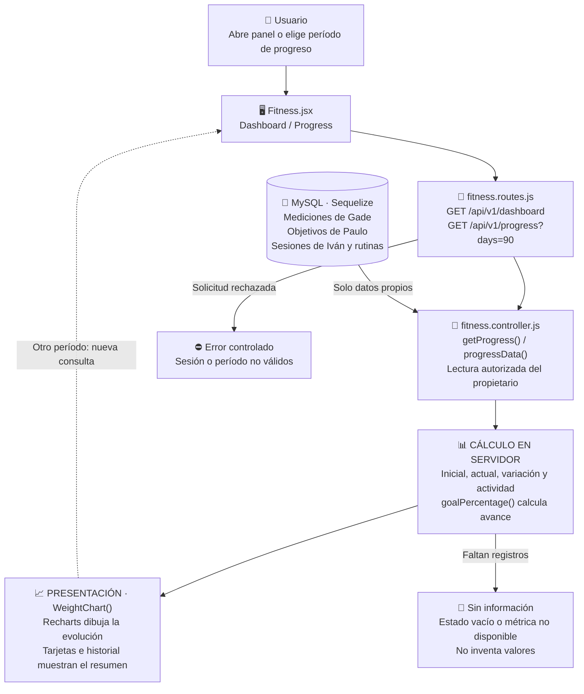

# Mateo Romani: Panel y visualización del progreso

Guía exclusiva de la **preentrega**, no de todas las funciones del proyecto final. Es una asignación de estudio y revisión; no afirma autoría histórica. El código se preparó con asistencia de Codex.

## Mapa visual para ubicarte

Tu pantalla reúne datos que ya cargaron otros módulos. Es una consulta: cambiar el período del gráfico no modifica las mediciones.

La base contiene las mediciones y sesiones; el servidor calcula el resumen; React y Recharts lo presentan. En la preentrega no hay consumo ni macros en tu bloque.

## Tu funcionalidad

**Casos:** CU011 y panel de resumen. **Pantallas:** `/dashboard, /progreso`.

No registrás alimentos ni macros en esta versión. Gade explica el formulario de medidas; Paulo las reglas de objetivos; vos sus resúmenes visibles.

## Archivos que tenés que ubicar

- [client/src/pages/Fitness.jsx](../client/src/pages/Fitness.jsx).
- [controllers/fitness.controller.js](../controllers/fitness.controller.js).
- [routes/fitness.routes.js](../routes/fitness.routes.js).
- [client/src/components/ui.jsx](../client/src/components/ui.jsx).

## Qué hace cada función importante

| Función                                                     | Para qué sirve                                                                        |
| ----------------------------------------------------------- | ------------------------------------------------------------------------------------- |
| [Dashboard](../client/src/pages/Fitness.jsx#L105)           | Muestra peso actual, sesiones y rutinas recientes; no consulta nutrición.             |
| [Progress](../client/src/pages/Fitness.jsx#L278)            | Carga un período de evolución, métricas, metas e historial de medidas.                |
| [WeightChart](../client/src/pages/Fitness.jsx#L51)          | Convierte mediciones en un gráfico temporal con descripción accesible y estado vacío. |
| [progressData](../controllers/fitness.controller.js#L270)   | Combina medidas, objetivos y sesiones propias sin mezclar usuarios.                   |
| [getProgress](../controllers/fitness.controller.js#L345)    | Autoriza lectura y devuelve el resumen del período solicitado.                        |
| [goalPercentage](../controllers/fitness.controller.js#L268) | Calcula avance desde valor inicial hacia objetivo, tanto para aumento como descenso.  |

Los enlaces llevan a la declaración real. Entendé qué recibe, qué valida, qué devuelve y qué puede fallar; no hace falta repetir cada palabra del código. Las operaciones de soporte compartidas se explican en [el recorrido común](README.md).

## Recorrido que tenés que poder explicar

Mediciones de Gade y sesiones de Iván -> resumen calculado en servidor -> gráfico/porcentaje -> selector de período -> recarga sin modificar registros.

**Datos afectados o consultados:** Lectura de mediciones_fisicas, objetivos, entrenamientos y rutinas. La pantalla no escribe SQL directamente: llama a Express y Sequelize se ocupa de las consultas. Las escrituras conservan autorización, transacción, bitácora e integridad.

## Librerías de tu recorrido

React administra filtros y estado; Recharts dibuja gráficas; Luxon organiza fechas y zonas horarias en servidor; Express y Sequelize/mysql2 entregan el resumen. No se calculan métricas con datos privados de otro usuario.

## Demostración para exponer

1. Mostrar el panel antes y después de registrar datos.
2. Cambiar el período de las gráficas.
3. Explicar diferencia entre peso inicial, actual y variación.
4. Demostrar aislamiento: una cuenta nueva no muestra datos de otra.

## Preguntas que deberías poder responder

- ¿Cuál es la diferencia entre esta pantalla y su ruta de API?
- ¿Qué datos entran, qué error se valida y qué respuesta recibe React?
- ¿Qué queda guardado y cómo se comprueba después de recargar?
- ¿Cómo se evita acceder a registros ajenos?
- ¿Qué operación se cancela sin cambiar la base?

## Límites de la preentrega

No hay nutrición, administración ni generación/adaptación IA de planes en esta copia. El chat sí usa Cohere real si la clave privada y su cuota están disponibles. La base conserva tablas del DER futuro, pero tener una tabla o un método UML declarado no equivale a una funcionalidad terminada. Consultá [alcance](../docs/ALCANCE.md) y [verificación](../docs/VERIFICACION.md).

Antes de exponer, registrá tus revisiones/aportes efectivos en [REPARTO.md](../REPARTO.md). No atribuyas cambios que no realizaste.
