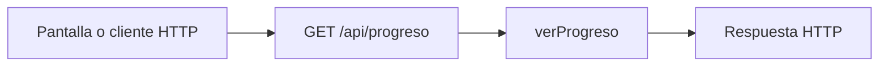

# Mateo Romani · endpoints de resumen y cálculo del progreso

Edición **50**. Tu responsabilidad principal son los **1 endpoints de la tabla siguiente**. Las funciones auxiliares y las consultas a rutas de otros compañeros se distinguen más abajo. Esto es un reparto para estudiar y defender, no una declaración de quién escribió el código.

## Tus endpoints concretos

| Método y ruta completa | Ruta en el código | Handler real | Acceso |
| --- | --- | --- | --- |
| `GET /api/progreso` | [routes/gimnasio.routes.js](../routes/gimnasio.routes.js#L26) | [verProgreso](../controllers/progreso.controller.js#L24) | Sesión requerida |

Las URLs de esta tabla incluyen `/api`. En React vas a ver llamadas como `axios.get("/cuenta")`: [App.jsx](../client/src/App.jsx) configura `axios.defaults.baseURL = "/api"`. No existe una ruta extra por cada función interna.

## Mapa de tus endpoints

En los endpoints privados, `verificarSesion` corre antes del handler. Las tablas y consultas concretas se explican por endpoint; el catálogo usa JSON local y `/ia/estado` lee configuración, no hacen consultas de negocio a MySQL.

## Explicación de cada endpoint

### `GET /api/progreso`

**Qué recibe.** Sin body ni id de usuario en la URL.

**Qué ejecuta y consulta.** Consulta `MedicionFisica`, `Objetivo` no eliminado, `Entrenamiento` completo y cuenta `Rutina` activa. En el 75 además cuenta `Dieta` activa. Agrupa/calcula valores en JavaScript.

**Qué valida o decide.** `calcularPorcentaje` compara inicio/actual/meta, limita a 0–100 y trata inicio=meta. Resistencia usa mejor distancia; frecuencia cuenta sesiones completas semanales. Objetivos completados cortan en `fecha_cierre`, incluso el mismo día.

**Respuesta correcta.** `200` → `{mediciones, objetivos: [...con valor_actual y porcentaje], entrenamientos_completados, rutinas}`; en 75 agrega `dietas`.

**Errores propios.** `500` si no puede consultar/calcular.

**Quién lo llama.** Progreso.jsx: `useEffect` carga el resumen y Recharts dibuja peso; es la pantalla Resumen, no una pestaña de Mi cuenta.

**Cómo mostrarlo.** Explicar el cálculo 80→70 con actual 75 =50 %, mostrar el gráfico y por qué una meta completada manualmente puede no medir 100 %.

## Funciones de apoyo: no son otros endpoints

Conocé para qué sirven cuando aparecen en el recorrido de tus rutas. No se asigna una ruta inexistente ni se cambia el responsable por compartir una función.

| Función auxiliar | Para qué interviene |
| --- | --- |
| [calcularPorcentaje](../controllers/progreso.controller.js#L8) | Calcula el avance y trata inicio=meta; no recibe HTTP. |

## Archivos que tenés que ubicar

- [controllers/progreso.controller.js](../controllers/progreso.controller.js): handlers y lógica de tus endpoints.
- [client/src/pages/Progreso.jsx](../client/src/pages/Progreso.jsx): estado, formulario o carga que llama a esas rutas.
- [models/index.js](../models/index.js): relaciones; seguí desde ahí solo los modelos usados en tus consultas.
- [auth.controller.js](../controllers/auth.controller.js#L5): antes de un handler privado comprueba cookie, JWT, sesión persistida y cuenta activa; deja el usuario en `req.user`.

## Lo mínimo común para defender estas rutas

Diferenciá `req.params` (id en la URL), `req.query` (filtros después de `?`), `req.body` (JSON enviado) y `req.user` (cuenta autenticada). El usuario propietario se toma de la sesión, no de un id arbitrario enviado por el formulario.

Todos los endpoints privados pueden responder `401` si la sesión falta, vence, se cierra o la cuenta no está habilitada; el middleware puede responder `500` si falla su comprobación. No confundas estos errores compartidos con los que devuelve el handler. El parser general también puede rechazar JSON inválido (`400`) o un body demasiado grande (`413`).

Para respuestas `204`, no hay JSON que leer. Para crear suele usarse `201`; para leer/editar, `200`. En Axios, el JSON está en `respuesta.data`; en DELETE, el body se pasa como `{data: {...}}`.

No hace falta estudiar todo el sistema ni el funcionamiento interno de Vite. Sí poder seguir tu request desde la pantalla hasta las consultas y explicar una respuesta de éxito y una condición de error.

Aunque tenés un endpoint, contiene cálculos de seis tipos de objetivo, corte temporal, consultas a varias tablas y la explicación del gráfico. Esa carga se compara con la lógica, no contando solo rutas.

## Librerías que intervienen

Sequelize reúne registros; Intl y Math son de JavaScript y calculan fecha local y porcentajes. React y Axios cargan el resumen y Recharts dibuja los valores reales.

## Coordinación con otros responsables

- Si necesitás datos de otra funcionalidad, consultá el índice general. Un `findAll` interno de tu controlador no equivale a llamar por HTTP a otro endpoint.

Consultá el [reparto completo](README.md) y el [alcance](../docs/ALCANCE.md) antes de prometer una ruta de otra entrega.

## Cómo leer el código simplificado

El recorrido sigue siendo pantalla React → ruta Express → controlador → modelo Sequelize → MySQL. No hay una capa de servicios. Las decisiones de negocio usan `if`/`else` y los recorridos usan `for (let i = 0; i < lista.length; i++)`. En cada vuelta, `lista[i]` es el elemento de esa posición; el nombre de la lista no tiene significado especial para JavaScript.

Se quitaron `for...of`, `?.`, `??` y `...` del código de controladores y pantallas. Los controladores ya no usan callbacks de `map`, `filter`, `find` o `some` ni comparadores de `sort`: las búsquedas, validaciones y cálculos están desplegados en bucles. En los formularios se construye una copia con los campos explícitos antes de llamar al setter de React; `slice()` copia una lista y `push()` agrega un elemento. No hay que modificar directamente el estado anterior.

En JSX se mantiene `map` únicamente para dibujar listas de elementos. Por ejemplo, `items.map((rutina) => <...>)` produce un bloque visual por rutina; no guarda datos ni llama a MySQL. `key` identifica cada fila para React. Algunas etiquetas usan un condicional sencillo `condicion ? textoSi : textoNo`; la validación del servidor está escrita con `if`. Las funciones de evento con `=>` y la desestructuración también aparecen en los ejemplos del curso: no son otra arquitectura.

No se afirma que todo el proyecto sea idéntico al repaso. El sistema tiene más funciones que un CRUD de ejemplo. Las protecciones conservadas se explican abajo según tu recorrido. [Criterio y diferencias conservadas](../docs/CRITERIO-DEL-PROFESOR.md).

### Tu recorrido, paso a paso

`verProgreso` consulta mediciones, objetivos y entrenamientos propios. Para cada objetivo, recorre los registros y conserva los anteriores a su cierre. Para resistencia busca la mayor distancia con un `for` y una comparación; para frecuencia cuenta entrenamientos de la semana; para peso/grasa toma la última medición válida. Si no hay mediciones usa el valor inicial, sin acceder a un elemento inexistente.

`calcularPorcentaje` calcula `(actual - inicial) / (meta - inicial) * 100`, limita el resultado entre 0 y 100 con `if` y redondea a un decimal. Cuando inicial y meta coinciden hay un caso separado para no dividir por cero. El objetivo cerrado conserva su fecha de corte.

Progreso.jsx carga con una función `async`, prepara `puntosMediciones` con un bucle y se los entrega al gráfico de Recharts. El gráfico dibuja; no decide el porcentaje ni modifica MySQL. `mostrarValorActual` muestra el cero real y solo usa "Sin medición" para un valor ausente.
