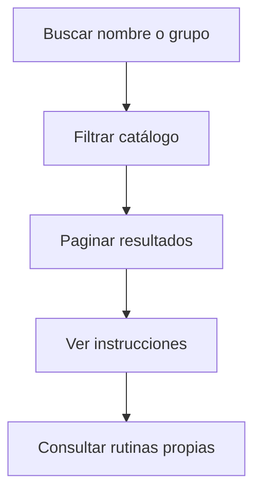

# Joaquín Casanou · Catálogo y consulta de rutinas

Responsabilidad de estudio y revisión de la edición 50; no es una declaración de autoría.

## Mapa mental

## Archivos y funciones

Pantalla: [Rutinas.jsx](../client/src/pages/Rutinas.jsx). Backend: [controllers/rutinas.controller.js](../controllers/rutinas.controller.js). Las rutas están en [usuarios.routes.js](../routes/usuarios.routes.js) y [gimnasio.routes.js](../routes/gimnasio.routes.js).

| Función | Qué hace y qué tenés que poder explicar |
| --- | --- |
| [listarEjercicios](../controllers/rutinas.controller.js#L215) | Busca por nombre/grupo, pagina de a 24 y devuelve instrucciones del catálogo textual. |
| [listarRutinas](../controllers/rutinas.controller.js#L105) | Carga planes propios con sus ejercicios ordenados y normaliza el día para el editor. |

## Librerías

React y Axios; Sequelize para Rutina/RutinaEjercicio/Objetivo; catálogo JSON de exercises-dataset con licencia conservada. No requiere imágenes ni llamadas externas para buscar ejercicios.

## Qué entender

La búsqueda es sobre un JSON local con licencia, no una API. Se pagina de a 24. Las rutinas se consultan por usuario y sus ejercicios se ordenan por día y posición. Diferenciá una ficha del catálogo de un ejercicio agregado al plan.

Ubicá useState, useEffect cuando se use, los eventos del formulario y las llamadas Axios. Para cada función explicá entradas, validación, consulta y respuesta; no hace falta memorizar palabra por palabra.

## Recorrido de defensa

Buscá squat, avanzá de página si corresponde y abrí instrucciones. Mostrá que las rutinas consultadas pertenecen al usuario conectado.

## Base común

Pantalla → ruta → controlador → modelo → MySQL. Las relaciones están en [models/index.js](../models/index.js). La confirmación está en [Confirmar.jsx](../client/src/components/Confirmar.jsx). Consultá el [alcance](../docs/ALCANCE.md). Vite solo inicia o compila React; no es una función del gimnasio ni hay que estudiar sus mecanismos internos.
