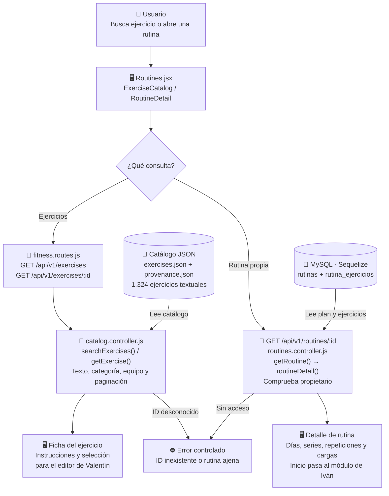

# Joaquín Casanou: Catálogo y consulta de ejercicios/rutinas

Guía exclusiva de la **preentrega**, no de todas las funciones del proyecto final. Es una asignación de estudio y revisión; no afirma autoría histórica. El código se preparó con asistencia de Codex.

## Mapa visual para ubicarte

Hay dos caminos de consulta: los ejercicios salen de un catálogo JSON y las rutinas propias salen de MySQL. Consultar un ejercicio no llama a Cohere.

El catálogo ayuda a elegir; la rutina contiene la planificación guardada. Tu bloque consulta y conecta pantallas; la edición manual corresponde a Valentín y la sesión deportiva a Iván.

## Tu funcionalidad

**Casos:** CU017 y catálogo de apoyo. **Pantallas:** `/ejercicios, /rutinas/:id`.

Tomás explica la IA; vos no tenés que estudiar Cohere. No hay imágenes/GIF del dataset con licencia separada: se usa el catálogo textual atribuido.

## Archivos que tenés que ubicar

- [client/src/pages/Routines.jsx](../client/src/pages/Routines.jsx).
- [controllers/catalog.controller.js](../controllers/catalog.controller.js).
- [controllers/routines.controller.js](../controllers/routines.controller.js).
- [models/exercises/exercises.json](../models/exercises/exercises.json).
- [models/exercises/provenance.json](../models/exercises/provenance.json).

## Qué hace cada función importante

| Función                                                     | Para qué sirve                                                                                  |
| ----------------------------------------------------------- | ----------------------------------------------------------------------------------------------- |
| [ExerciseCatalog](../client/src/pages/Routines.jsx#L42)     | Busca, filtra y pagina ejercicios; abre instrucciones y permite seleccionar uno para la rutina. |
| [searchExercises](../controllers/catalog.controller.js#L56) | Filtra el catálogo textual por consulta, categoría y equipo; no llama a un modelo IA.           |
| [getExercise](../controllers/catalog.controller.js#L51)     | Valida el identificador y devuelve un ejercicio o error si no existe.                           |
| [RoutineDetail](../client/src/pages/Routines.jsx#L504)      | Presenta días, ejercicios, series y cargas del plan, y da acceso al inicio del entrenamiento.   |
| [getRoutine](../controllers/routines.controller.js#L41)     | Autoriza consulta y restringe el plan al propietario.                                           |
| [routineDetail](../controllers/routines.controller.js#L16)  | Carga rutina y ejercicios ordenados sin permitir leer los de otro usuario.                      |

Los enlaces llevan a la declaración real. Entendé qué recibe, qué valida, qué devuelve y qué puede fallar; no hace falta repetir cada palabra del código. Las operaciones de soporte compartidas se explican en [el recorrido común](README.md).

## Recorrido que tenés que poder explicar

Consulta/filtros -> catálogo paginado -> detalle de ejercicio -> selección en formulario de Valentín. La consulta de rutina lee MySQL; el catálogo base se carga desde JSON.

**Datos afectados o consultados:** Catálogo JSON de 1324 ejercicios; lectura de rutinas y rutina_ejercicios. La pantalla no escribe SQL directamente: llama a Express y Sequelize se ocupa de las consultas. Las escrituras conservan autorización, transacción, bitácora e integridad.

## Librerías de tu recorrido

React y React Router administran pantallas y acciones. Express recibe solicitudes; Zod valida contratos; Sequelize/mysql2 persisten o consultan MySQL. En cuentas se usan crypto de Node y Nodemailer para seguridad y recuperación; el correo de desarrollo es un archivo, no un envío real. Estudiá las librerías que realmente intervienen en tu función, no las dependencias completas.

## Demostración para exponer

1. Buscar un ejercicio y filtrar por categoría/equipo.
2. Abrir sus instrucciones.
3. Seleccionarlo al construir una rutina.
4. Mostrar detalle de rutina y rechazar un ID inexistente.

## Preguntas que deberías poder responder

- ¿Cuál es la diferencia entre esta pantalla y su ruta de API?
- ¿Qué datos entran, qué error se valida y qué respuesta recibe React?
- ¿Qué queda guardado y cómo se comprueba después de recargar?
- ¿Cómo se evita acceder a registros ajenos?
- ¿Qué operación se cancela sin cambiar la base?

## Límites de la preentrega

No hay nutrición, administración ni generación/adaptación IA de planes en esta copia. El chat sí usa Cohere real si la clave privada y su cuota están disponibles. La base conserva tablas del DER futuro, pero tener una tabla o un método UML declarado no equivale a una funcionalidad terminada. Consultá [alcance](../docs/ALCANCE.md) y [verificación](../docs/VERIFICACION.md).

Antes de exponer, registrá tus revisiones/aportes efectivos en [REPARTO.md](../REPARTO.md). No atribuyas cambios que no realizaste.
