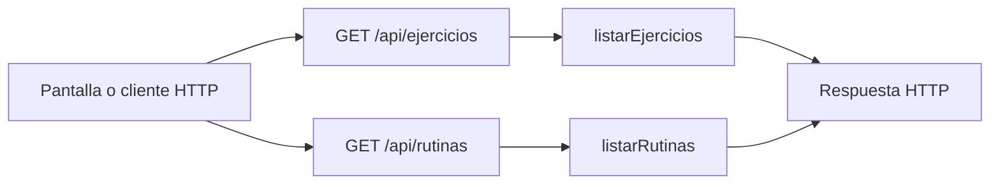

# Joaquín Casanou · endpoints de catálogo y consulta de rutinas

Edición **50**. Tu responsabilidad principal son los **2 endpoints de la tabla siguiente**. Las funciones auxiliares y las consultas a rutas de otros compañeros se distinguen más abajo. Esto es un reparto para estudiar y defender, no una declaración de quién escribió el código.

## Tus endpoints concretos

| Método y ruta completa | Ruta en el código | Handler real | Acceso |
| --- | --- | --- | --- |
| `GET /api/ejercicios` | [routes/gimnasio.routes.js](../routes/gimnasio.routes.js#L22) | [listarEjercicios](../controllers/rutinas.controller.js#L367) | Sesión requerida |
| `GET /api/rutinas` | [routes/gimnasio.routes.js](../routes/gimnasio.routes.js#L18) | [listarRutinas](../controllers/rutinas.controller.js#L177) | Sesión requerida |

Las URLs de esta tabla incluyen `/api`. En React vas a ver llamadas como `axios.get("/cuenta")`: [App.jsx](../client/src/App.jsx) configura `axios.defaults.baseURL = "/api"`. No existe una ruta extra por cada función interna.

## Mapa de tus endpoints

En los endpoints privados, `verificarSesion` corre antes del handler. Las tablas y consultas concretas se explican por endpoint; el catálogo usa JSON local y `/ia/estado` lee configuración, no hacen consultas de negocio a MySQL.

## Explicación de cada endpoint

### `GET /api/ejercicios`

**Qué recibe.** Query opcional: `buscar`, `grupo`, `pagina` (desde 1). Sin body.

**Qué ejecuta y consulta.** Carga el JSON local de `models/exercises/exercises.json`; filtra nombre/body_part, arma grupos y corta de a 24. No consulta MySQL para el catálogo; la autenticación sí consultó la sesión.

**Qué valida o decide.** Búsqueda de nombre/grupo en inglés sin distinguir mayúsculas; `grupo` filtra coincidencia exacta. Página limitada a 1–1000. No descarga GIF ni llama una API externa.

**Respuesta correcta.** `200` → `{items, total, pagina, grupos}`.

**Errores propios.** No tiene un error de negocio explícito; aplican autenticación y el error general del servidor si algo inesperado falla.

**Quién lo llama.** Rutinas.jsx: `buscar`, botones de paginación y `agregarFicha`.

**Cómo mostrarlo.** Buscar squat, abrir instrucciones, paginar y agregar una ficha al editor; todavía hay que guardar la rutina.

### `GET /api/rutinas`

**Qué recibe.** Sin body.

**Qué ejecuta y consulta.** `Rutina.findAll` por usuario y estado distinto de eliminada, con `include` de `RutinaEjercicio`. El `order` de Sequelize pide a MySQL rutinas por fecha y ejercicios por día/posición. Un bucle tradicional convierte cada rutina a JSON y normaliza el día a número; ya no hay comparador `sort`.

**Qué valida o decide.** No hay un `GET /rutinas/:id`: este listado ya trae los detalles y la interfaz muestra cada rutina.

**Respuesta correcta.** `200` → `{items: [...]}` con `ejercicios` dentro de cada plan.

**Errores propios.** `500` si no puede consultar.

**Quién lo llama.** Rutinas.jsx: `cargar`; Entrenamientos.jsx lo usa como selector. En el 75 también Asistente.jsx lo consulta para elegir un plan a adaptar.

**Cómo mostrarlo.** Mostrar una rutina completa desde el listado y explicar el include y la ordenación.

## Funciones de apoyo: no son otros endpoints

Conocé para qué sirven cuando aparecen en el recorrido de tus rutas. No se asigna una ruta inexistente ni se cambia el responsable por compartir una función.

| Función auxiliar | Para qué interviene |
| --- | --- |
| Lógica dentro de los handlers | No tiene una función auxiliar local adicional asignada. Consultá las relaciones de modelos y las funciones React del recorrido. |

## Archivos que tenés que ubicar

- [controllers/rutinas.controller.js](../controllers/rutinas.controller.js): handlers y lógica de tus endpoints.
- [client/src/pages/Rutinas.jsx](../client/src/pages/Rutinas.jsx): estado, formulario o carga que llama a esas rutas.
- [models/index.js](../models/index.js): relaciones; seguí desde ahí solo los modelos usados en tus consultas.
- [auth.controller.js](../controllers/auth.controller.js#L5): antes de un handler privado comprueba cookie, JWT, sesión persistida y cuenta activa; deja el usuario en `req.user`.

## Lo mínimo común para defender estas rutas

Diferenciá `req.params` (id en la URL), `req.query` (filtros después de `?`), `req.body` (JSON enviado) y `req.user` (cuenta autenticada). El usuario propietario se toma de la sesión, no de un id arbitrario enviado por el formulario.

Todos los endpoints privados pueden responder `401` si la sesión falta, vence, se cierra o la cuenta no está habilitada; el middleware puede responder `500` si falla su comprobación. No confundas estos errores compartidos con los que devuelve el handler. El parser general también puede rechazar JSON inválido (`400`) o un body demasiado grande (`413`).

Para respuestas `204`, no hay JSON que leer. Para crear suele usarse `201`; para leer/editar, `200`. En Axios, el JSON está en `respuesta.data`; en DELETE, el body se pasa como `{data: {...}}`.

No hace falta estudiar todo el sistema ni el funcionamiento interno de Vite. Sí poder seguir tu request desde la pantalla hasta las consultas y explicar una respuesta de éxito y una condición de error.

## Librerías que intervienen

React y Axios buscan y muestran fichas; Express conecta con el controlador. El catálogo se lee con require desde un JSON local, sin proveedor externo. Sequelize consulta rutinas con include de sus ejercicios.

## Coordinación con otros responsables

- `GET /api/objetivos`: responsable **Paulo López**. Entendé qué recibe y devuelve; no se vuelve a asignar como endpoint tuyo.

Consultá el [reparto completo](README.md) y el [alcance](../docs/ALCANCE.md) antes de prometer una ruta de otra entrega.

## Cómo leer el código simplificado

El recorrido sigue siendo pantalla React → ruta Express → controlador → modelo Sequelize → MySQL. No hay una capa de servicios. Las decisiones de negocio usan `if`/`else` y los recorridos usan `for (let i = 0; i < lista.length; i++)`. En cada vuelta, `lista[i]` es el elemento de esa posición; el nombre de la lista no tiene significado especial para JavaScript.

Se quitaron `for...of`, `?.`, `??` y `...` del código de controladores y pantallas. Los controladores ya no usan callbacks de `map`, `filter`, `find` o `some` ni comparadores de `sort`: las búsquedas, validaciones y cálculos están desplegados en bucles. En los formularios se construye una copia con los campos explícitos antes de llamar al setter de React; `slice()` copia una lista y `push()` agrega un elemento. No hay que modificar directamente el estado anterior.

En JSX se mantiene `map` únicamente para dibujar listas de elementos. Por ejemplo, `items.map((rutina) => <...>)` produce un bloque visual por rutina; no guarda datos ni llama a MySQL. `key` identifica cada fila para React. Algunas etiquetas usan un condicional sencillo `condicion ? textoSi : textoNo`; la validación del servidor está escrita con `if`. Las funciones de evento con `=>` y la desestructuración también aparecen en los ejemplos del curso: no son otra arquitectura.

No se afirma que todo el proyecto sea idéntico al repaso. El sistema tiene más funciones que un CRUD de ejemplo. Las protecciones conservadas se explican abajo según tu recorrido. [Criterio y diferencias conservadas](../docs/CRITERIO-DEL-PROFESOR.md).

### Tu recorrido, paso a paso

`listarEjercicios` recorre el catálogo local y agrega los que coinciden con texto y grupo. La paginación usa `slice`. El `sort()` restante ordena nombres de grupos alfabéticamente sin callback ni comparador numérico. No consulta una API externa.

`listarRutinas` pide el orden por fecha/día/posición directamente a MySQL; después recorre registros para convertirlos a JSON y normalizar el día.
