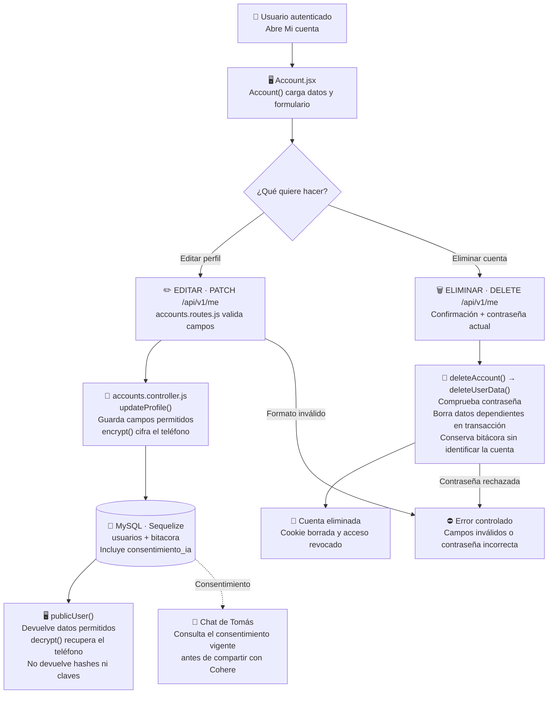

# Simón Castellani: Mi cuenta y datos personales

Guía exclusiva de la **preentrega**, no de todas las funciones del proyecto final. Es una asignación de estudio y revisión; no afirma autoría histórica. El código se preparó con asistencia de Codex.

## Mapa visual para ubicarte

Mi cuenta modifica a la persona que inició sesión. Editar el perfil y eliminar la cuenta siguen caminos distintos; el borrado pide contraseña y confirmación.

Gianluca maneja ingreso y recuperación; vos manejás el perfil propio y su borrado. Revocar consentimiento impide nuevas consultas al proveedor, pero no equivale a eliminar el historial ya guardado.

## Tu funcionalidad

**Casos:** CU005, CU006. **Pantallas:** `/me`.

No hay administración de terceros en la preentrega. Acceso/recuperación pertenecen a Gianluca; no compartas una contraseña real al demostrar el borrado.

## Archivos que tenés que ubicar

- [client/src/pages/Account.jsx](../client/src/pages/Account.jsx).
- [controllers/accounts.controller.js](../controllers/accounts.controller.js).
- [routes/accounts.routes.js](../routes/accounts.routes.js).
- [controllers/security.controller.js](../controllers/security.controller.js).

## Qué hace cada función importante

| Función                                                      | Para qué sirve                                                                                   |
| ------------------------------------------------------------ | ------------------------------------------------------------------------------------------------ |
| [Account](../client/src/pages/Account.jsx#L6)                | Edita datos personales y consentimiento; pide contraseña y confirmación para eliminar la cuenta. |
| [publicUser](../controllers/accounts.controller.js#L26)      | Devuelve solo campos públicos y teléfono descifrado; nunca expone hashes o secretos.             |
| [updateProfile](../controllers/accounts.controller.js#L168)  | Modifica únicamente los campos permitidos y audita la operación.                                 |
| [deleteAccount](../controllers/accounts.controller.js#L319)  | Verifica la contraseña y confirma eliminación de datos propios.                                  |
| [deleteUserData](../controllers/accounts.controller.js#L262) | Elimina registros dependientes dentro de una transacción y desasocia bitácora.                   |
| [encrypt](../controllers/security.controller.js#L42)         | Cifra teléfono con AES-256-GCM y un nonce; no se guarda texto directo.                           |
| [decrypt](../controllers/security.controller.js#L44)         | Descifra datos solo en servidor, con comprobación de autenticidad.                               |

Los enlaces llevan a la declaración real. Entendé qué recibe, qué valida, qué devuelve y qué puede fallar; no hace falta repetir cada palabra del código. Las operaciones de soporte compartidas se explican en [el recorrido común](README.md).

## Recorrido que tenés que poder explicar

Editar perfil -> PATCH /me -> campos permitidos/cifrado -> MySQL -> datos públicos. Eliminar: confirmar más contraseña -> borrado dependiente -> sesión deja de autenticar.

**Datos afectados o consultados:** usuarios y sus datos dependientes; bitacora conserva eventos sin identificar a la cuenta eliminada. La pantalla no escribe SQL directamente: llama a Express y Sequelize se ocupa de las consultas. Las escrituras conservan autorización, transacción, bitácora e integridad.

## Librerías de tu recorrido

React y React Router administran pantallas y acciones. Express recibe solicitudes; Zod valida contratos; Sequelize/mysql2 persisten o consultan MySQL. En cuentas se usan crypto de Node y Nodemailer para seguridad y recuperación; el correo de desarrollo es un archivo, no un envío real. Estudiá las librerías que realmente intervienen en tu función, no las dependencias completas.

## Demostración para exponer

1. Editar nombre o teléfono y recargar.
2. Activar y revocar consentimiento para el chat de Tomás.
3. Probar datos inválidos sin perder formulario.
4. Con una cuenta ficticia, cancelar eliminación y luego confirmar; comprobar que no permite entrar otra vez.

## Preguntas que deberías poder responder

- ¿Cuál es la diferencia entre esta pantalla y su ruta de API?
- ¿Qué datos entran, qué error se valida y qué respuesta recibe React?
- ¿Qué queda guardado y cómo se comprueba después de recargar?
- ¿Cómo se evita acceder a registros ajenos?
- ¿Qué operación se cancela sin cambiar la base?

## Límites de la preentrega

No hay nutrición, administración ni generación/adaptación IA de planes en esta copia. El chat sí usa Cohere real si la clave privada y su cuota están disponibles. La base conserva tablas del DER futuro, pero tener una tabla o un método UML declarado no equivale a una funcionalidad terminada. Consultá [alcance](../docs/ALCANCE.md) y [verificación](../docs/VERIFICACION.md).

Antes de exponer, registrá tus revisiones/aportes efectivos en [REPARTO.md](../REPARTO.md). No atribuyas cambios que no realizaste.
