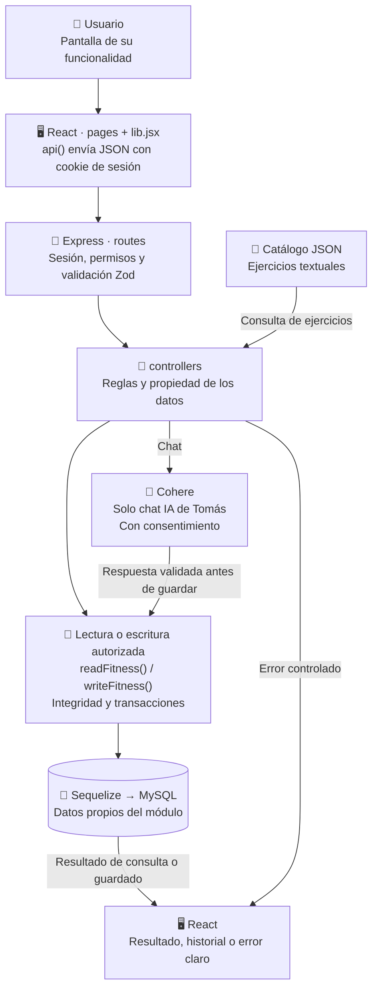

# Cómo estudiar la preentrega

Nueve guías, una función visible por persona. La lista y el orden de exposición están en [REPARTO](../REPARTO.md). Este es el corte parcial; no estudiar desde guías del final para explicar funciones ausentes.

| Integrante         | Funcionalidad                             | Guía                              |
| ------------------ | ----------------------------------------- | --------------------------------- |
| Gianluca Pizarro   | Acceso y recuperación                     | [Abrir](01-gianluca-pizarro.md)   |
| Tomás Menossi      | Chat con inteligencia artificial          | [Abrir](02-tomas-menossi.md)      |
| Iván Lerner        | Entrenamientos e historial                | [Abrir](03-ivan-lerner.md)        |
| Paulo López        | Objetivos personales                      | [Abrir](04-paulo-lopez.md)        |
| Gade Silva y Lápiz | Mediciones y perfil físico                | [Abrir](05-gade-silva-y-lapiz.md) |
| Valentín Schueld   | Rutinas manuales                          | [Abrir](06-valentin-schueld.md)   |
| Mateo Romani       | Panel y visualización del progreso        | [Abrir](07-mateo-romani.md)       |
| Joaquín Casanou    | Catálogo y consulta de ejercicios/rutinas | [Abrir](08-joaquin-casanou.md)    |
| Simón Castellani   | Mi cuenta y datos personales              | [Abrir](09-simon-castellani.md)   |

## Mapa visual para ubicarte

Este recorrido común ubica las piezas que se repiten en los nueve bloques. Cada guía individual agrega sus funciones, tablas y reglas específicas.



El mapa muestra conexiones, no una promesa de que cada módulo usa todos los servicios. La preentrega no tiene nutrición, administración ni generación IA de planes.

## Lo mínimo que conocen todos

JavaScript en frontend y backend. React dibuja las pantallas y React Router decide la vista. Express recibe HTTP. Zod valida datos. Los controladores aplican reglas; Sequelize y mysql2 acceden a MySQL 8.4.

```text
Pantalla React -> client/src/lib.jsx (api) -> routes/
-> sesión/permisos -> controllers/ -> models/Sequelize -> MySQL
-> respuesta pública -> estado React -> pantalla
```

La cookie `gymos_preentrega_session` es HttpOnly y distinta de la del final. El navegador envía la cookie pero no lee su contenido desde JavaScript. La clave Cohere queda en `.env` del servidor.

- `index.js`: prepara middleware, rutas, control de origen, errores y archivos del frontend.
- `controllers/auth.controller.js`: `requireAuth` valida sesión; `permit` exige permiso efectivo.
- `controllers/access.controller.js`: `authorizeActor` vuelve a comprobar cuenta y permiso al ejecutar operaciones.
- `controllers/domain.controller.js`: `owned` restringe al propietario; `dto` elimina campos internos; `readFitness`/`writeFitness` coordinan acceso y persistencia. El guardado IA comprueba otra vez consentimiento.
- `controllers/integrity.controller.js`: `atomic` verifica y firma cambios en transacción; `verified` comprueba lecturas; `audit` registra el evento. No reparar firmas a mano.
- `config/schema.js` y `config/migrate.js`: DER y migraciones. La base es propia de la preentrega; arrancar no borra datos.
- `models/uml.model.js`: conserva los métodos literales académicos. Un método declarado sin ruta implementada no cuenta como caso finalizado.
- `useResource`: carga/reintenta datos; `useAction`: maneja espera, error y éxito; `AuthProvider`: comparte sesión. Están en `client/src/lib.jsx`.

## Para practicar

Seguí el README, usá datos inventados y mostrá una acción válida, un rechazo y una cancelación. Recargá para verificar persistencia. No proyectes `.env`, archivos de correo o contraseñas. Para IA, explicá la diferencia entre Cohere real y `AI_MOCK`, que solo es diagnóstico.

La preentrega usa interfaz 5174, API 3002 y MySQL 3309. El final sigue en 5173/3000/3307.

## Cómo ver los diagramas

Cada guía individual incluye su mapa visual en este mismo archivo de estudio. Abrí el MD en la vista previa de GitHub: los bloques Mermaid se dibujan como diagramas. Seguí las flechas desde la pantalla hasta los datos y el resultado; las conexiones punteadas indican contexto o relación entre módulos. Son mapas de estudio simplificados y no reemplazan los UML ni los diagramas de secuencia.
